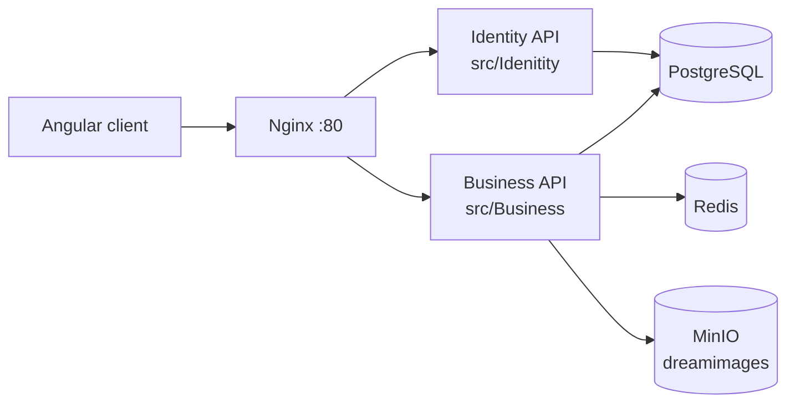

# DreamsShop

A full-stack study shop where producers list “dreams,” consumers browse and order them, and an identity service handles registration and JWT login.

The root README in the repo is only a two-step Docker Compose hint. This draft is based on the code under `src/`. The identity project folder is spelled `Idenitity` in the repository; commands below use that path as-is.

<!-- Screenshot: add a catalog or dream-detail screenshot here, e.g.  -->

## Features

- **Two user types** — consumers and producers (provider role) register and log in separately; an admin role exists in the domain. Refresh tokens are stored in cookies; access tokens are JWTs (the Angular client sends them with an HTTP interceptor).
- **Dream catalog** — paginated list (`skip` / `take`), single-dream fetch, and a count endpoint. Create/update accept a multipart form including an image; images are stored in **MinIO**.
- **Categories** — create, list, get, update, and delete categories (writes are admin-only). Dreams can be attached to or detached from categories (admin-only).
- **Orders** — a consumer can create an order and list or fetch their orders. The Angular app has a basket/order page.
- **Authorization** — dream write operations require the Provider or Admin role (`DreamOperationsPolicy`). Order writes require the Consumer role.
- **Caching** — Redis is used for dream list/detail and order queries.
- **Angular client** — routes for the dream list, dream detail, login, registration, profile, and order basket. Nginx serves the production build and proxies `/identity/` and `/business/` in the Compose stack.
- **API collection** — Bruno requests under `DreamsShop_Bruno/` (consumer and producer auth, dreams, orders, consumer delete).
- **Tests** — xUnit tests for the identity repositories and consumer registration (`src/Idenitity/Tests`). The Business `Tests` project exists but currently has no test classes. The Angular app has Karma specs (`npm test`).

## Tech stack

### Backend (both services target `net8.0`)

- ASP.NET Core 8, controllers, JWT Bearer
- Clean-style layering: Domain, Application (MediatR, AutoMapper, FluentValidation), Infrastructure, Presentation
- **Entity Framework Core** + **PostgreSQL**
- **Redis** (`Microsoft.Extensions.Caching.StackExchangeRedis`)
- **MinIO** .NET client for dream images
- EF migrations are applied at startup (`Database.Migrate()`)

### Frontend

- **Angular 20** with Angular Material and the Angular CDK
- Production image builds the app with `npm run build --configuration=production` and copies `dist/Client/browser` to a shared volume for Nginx

### Infrastructure

- `src/docker-compose.yml`: Nginx (`:80`), Angular build sidecar, Identity, Business, Postgres, MinIO (`:9000` / console `:9001`), Redis (`:6379`)
- Identity also publishes `:5001` (HTTP) and `:8081`; Business publishes `:5002` (HTTP) and `:8082`

## Architecture



Each API is its own solution with the same layering:

```
Presentation  →  Application (use cases / MediatR)  →  Domain
                     ↓
               Infrastructure (EF, Redis, MinIO, JWT helpers)
```

Connection strings and JWT settings live in each service’s `appsettings.json`. Production-style values in those files and in `docker-compose.yml` target the Compose network (host `postgres`, database names `DreamsShop_Business` and `DreamsShop_Identity`). Prefer editing those files or environment variables rather than copying secrets into a public README.

## How to run

### Docker Compose (documented in the existing root README)

Both API Dockerfiles copy `https/dev-certificate.pfx` from `src/Business/https/` and `src/Idenitity/https/`. Those files are **gitignored**, and the repo has no script that creates them. Place a development certificate at each path before building the API images.

```bash
cd src
docker compose up --build
```

`src/docker-compose.override.yml` is present but empty. The Angular production build is written into a volume that Nginx serves from `/usr/share/nginx/html/browser`. The client’s `environment.ts` (used for local configuration) calls:

- `http://localhost:80/business/api/`
- `http://localhost:80/identity/api/`

Compose also maps the API HTTP ports (`5001`, `5002`) directly to the host.

Each API calls `ApplyDatabaseMigration()` on startup. Compose creates a Postgres database named `DreamsShop_Business` (`POSTGRES_DB`). The Identity connection string uses database `DreamsShop_Identity`; if that database is not created automatically in your Postgres image, you may need to create it once. This was not verified by running the stack.

### Angular dev server (without the Nginx image)

```bash
cd src/Client
npm install
npm start
```

`package.json` defines `start` as `ng serve` (default `http://localhost:4200/`). The CORS policy on both APIs allows `http://localhost:4200`. The checked-in `environment.ts` still points at `http://localhost:80/...`, so the Compose/Nginx frontend proxy, or a matching environment change, is needed for API calls.

Other client scripts that exist: `npm run build`, `npm run watch`, `npm test`. There is no configured `e2e` project in this repo.

### Identity unit tests

```bash
dotnet test src/Idenitity/Tests/Tests.csproj
```

## Project structure

```
src/docker-compose.yml
src/nginx/                  # reverse proxy for the Angular build and APIs
src/Client/                 # Angular 20 app
src/Business/               # catalog, categories, orders, MinIO, Redis
  Business.sln
  Presentation/             # controllers: Dream, Category, DreamCategory, Order
  Application/ UseCases/
  Domain/ Infrastructure/ Tests/
src/Idenitity/              # spelling as in the repo
  Idenitity.sln
  Presentation/Controllers/ # ConsumerAuth, ProducerAuth, ConsumerUser
  Application/ Domain/ Infrastructure/ Tests/
DreamsShop_Bruno/           # Bruno API collection
diagrams/                   # entity diagrams and a .drawio.png
```
